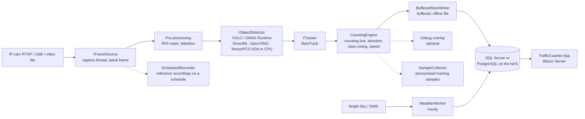
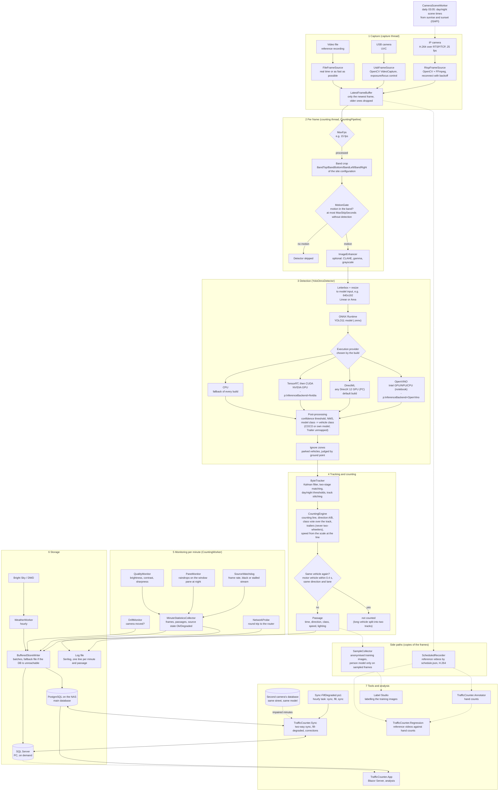
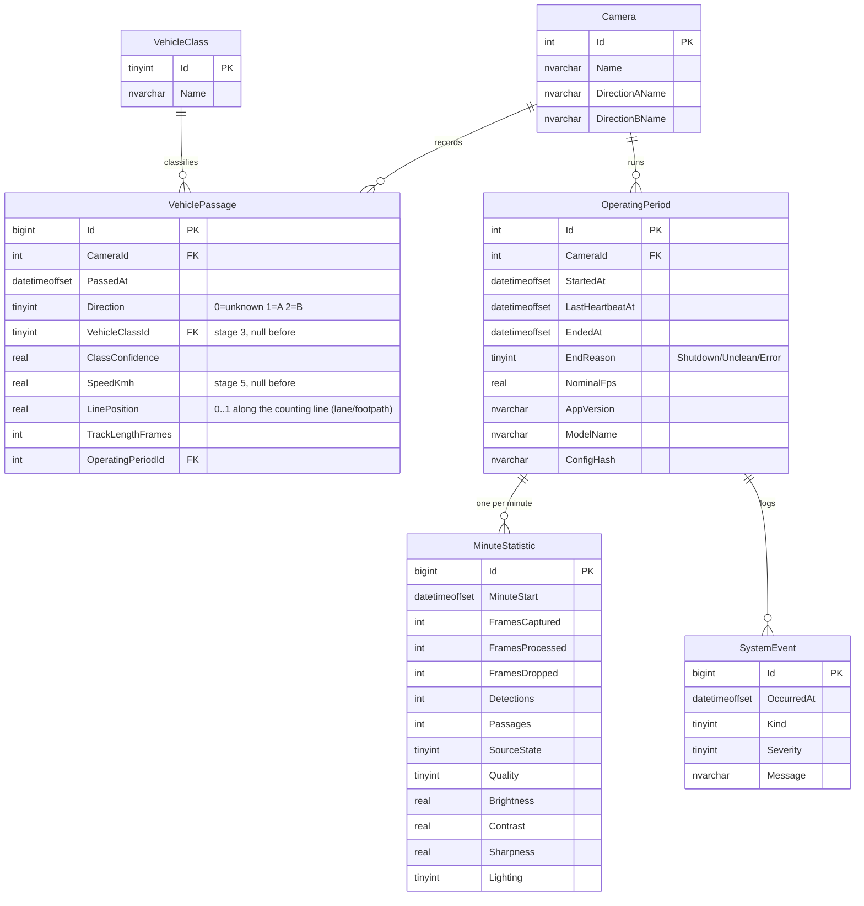

# Architecture

## Processing pipeline



The pipeline runs in a `BackgroundService`. Next to it, the service runs:

- the weather import (`WeatherWorker`, [ADR-0023](adr/0023-weather-and-image-quality.md));
- on request, reference recordings on a schedule (`ScheduledRecorder`, [ADR-0032](adr/0032-recordings-by-the-service.md)). They get a copy of the camera frames; counting never waits for them;
- on request, the collection of anonymised training samples (`SampleCollector`, [ADR-0026](adr/0026-targeted-collection-of-training-samples.md)), limited in time and per day.

Capture and processing are decoupled: the capture thread reads the stream continuously and keeps only the latest frame. If detection is slower than the camera, frames are discarded instead of buffered, so no latency can build up. Every frame carries its own timestamp; this keeps tracking and speed correct even when frames are missing.

## Complete chain in detail

From the camera to the analysis app, with the class or tool that does each step. Dashed lines are side paths that never hold up the counting.



Step 2 and the motion gate are described in [ADR-0029](adr/0029-computing-load.md), the band edges in [ADR-0040](adr/0040-band-sides.md), the execution providers in [ADR-0007](adr/0007-hardware-acceleration.md), [ADR-0029](adr/0029-computing-load.md) and [ADR-0041](adr/0041-tensorrt-backend.md), trailers, two-wheelers and split tracks in [ADR-0013](adr/0013-vehicle-classes.md) and [ADR-0046](adr/0046-two-wheelers-and-split-tracks.md), the camera scene times in [ADR-0042](adr/0042-camera-scene-times.md), the side paths in [ADR-0026](adr/0026-targeted-collection-of-training-samples.md) and [ADR-0032](adr/0032-recordings-by-the-service.md), the databases and the fill from a second camera in [ADR-0030](adr/0030-postgresql-and-synchronisation.md) and [operations.md](operations.md).

## Project structure (public repo)

```
TrafficCounter/
├─ docs/                       roadmap, architecture, guides, ADRs
├─ src/
│  ├─ TrafficCounter.Core/            domain model, geometry, image-independent interfaces (ITracker, ITrafficStore), operations log
│  ├─ TrafficCounter.Vision/          OpenCvSharp: frame sources, IObjectDetector, recording, anonymisation, measurements
│  ├─ TrafficCounter.Detection.Onnx/  YOLO inference with ONNX Runtime (DirectML/CPU, or OpenVINO as a separate build)
│  ├─ TrafficCounter.Tracking/        ByteTrack, Kalman filter, track stitching
│  ├─ TrafficCounter.Counting/        counting line, direction, class voting, trailers, speed
│  ├─ TrafficCounter.Pipeline/        processing per frame (detection → tracking → counting), site geometry, preview
│  ├─ TrafficCounter.Data/            EF Core (SQL Server and PostgreSQL), migrations, synchronisation, weather import
│  ├─ TrafficCounter.Evaluation/      ground truth format, comparison count ↔ ground truth, speed test drives
│  ├─ TrafficCounter.Service/         worker service (console + Windows service), scheduled recordings, sample collection
│  ├─ TrafficCounter.CameraProbe/     tool: check camera capabilities, live view, record and compress reference videos
│  ├─ TrafficCounter.Annotator/       tool: count reference videos by key press (ground truth), mark speed test drives
│  ├─ TrafficCounter.Calibrator/      tool: set band, counting line, kerbs, static zones, ignore zones (later homography)
│  ├─ TrafficCounter.Regression/      tool: evaluate reference videos against ground truth, live comparison, speed calibration and test drives
│  ├─ TrafficCounter.Sync/            tool: set up PostgreSQL, synchronise databases, load weather, rescale speeds
│  ├─ TrafficCounter.DemoData/        tool: fill a demo database with synthetic traffic
│  └─ TrafficCounter.App/             analysis app (stage 4, Blazor Server): overview, period, weekly and daily pattern, speed, operations
├─ tests/
│  └─ TrafficCounter.*.Tests/         unit, scenario and end-to-end tests (xUnit v3); SQL integration tests with TRAFFICCOUNTER_TEST_DB
├─ config/
│  └─ site.example.json               template of the private site configuration
└─ tools/
   ├─ deploy/                         packages and installation scripts for service and app (Windows services)
   ├─ setup/                          script that creates the private data repository
   └─ training/                       Python scripts: export to ONNX, quantisation, later fine-tuning
```

Projects are only created once they get content. Interfaces that contain image data (`Mat`), i.e. `IFrameSource` and `IObjectDetector`, are in `TrafficCounter.Vision`.

Dependencies only point inwards: `Core` knows neither OpenCV nor ONNX nor EF Core. This makes it possible to test counting and tracking logic without a camera and without a GPU.

## Private repo

```
TrafficCounterPrivate/
├─ config/        site-specific configuration (counting line, ROI, scale, direction names), reference notes
├─ recordings/    reference videos + ground truth counts (Git LFS)
├─ datasets/      training images and labels (Git LFS), inbox of collected samples
├─ models/        models (.pt/.onnx, Git LFS)
├─ db/            backups of the real database (Git LFS)
└─ reports/       generated analyses
```

`tools/setup/New-PrivateRepository.ps1` creates this structure. The service finds the private configuration via the environment variable `TRAFFICCOUNTER_CONFIG` (path to a JSON file). **Secrets** such as the RTSP password or the connection string are not checked in, not even in the private repo. They are in user secrets or environment variables.

## Data model (forward-compatible up to stage 5)



The diagram shows the core tables. In addition there are `DriftMeasurement` (camera position, [ADR-0019](adr/0019-camera-position-monitoring.md)) and `WeatherHour` (hourly weather, [ADR-0023](adr/0023-weather-and-image-quality.md)); passages also carry lighting, trailer count, source and track details, and all synchronised rows carry `SyncId`/`UpdatedAt` ([ADR-0030](adr/0030-postgresql-and-synchronisation.md)).

`OperatingPeriod`, `MinuteStatistic` and `SystemEvent` answer for every minute whether the system was off, ran but could not evaluate anything, or ran and there really was no traffic ([ADR-0024](adr/0024-operations-log-and-logging.md)). Without this information the statistics in stage 4 are not reliable.
